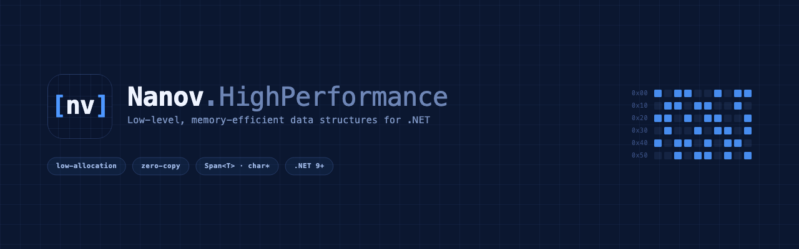

<p align="center">
  
</p>

# Nanov.HighPerformance

High-performance, low-allocation concurrency building blocks for .NET — zero per-message allocation,
lock-free where it counts, AOT-compatible. Targets **net9.0** and **net10.0**.

The repository is organized as focused, independently-packaged libraries. Today there is one:

| Library | Package | What it is |
| --- | --- | --- |
| **[Threading.Workers](src/Nanov.HighPerformance.Threading.Workers/README.md)** | `Nanov.HighPerformance.Threading.Workers` | The **SPSC worker family** — bounded-mailbox actors / pipeline stages backed by a power-of-two ring buffer. Sync & async, copy & zero-copy, plus key-conflating (last-wins) and key-coalescing (exactly-once) workers. |

→ **See the [Threading.Workers README](src/Nanov.HighPerformance.Threading.Workers/README.md)** for the
full API, semantics, usage, and performance notes.

## Layout

| Path | Purpose |
| --- | --- |
| `src/Nanov.HighPerformance.Threading.Workers` | The SPSC worker family library. |
| `tests/Nanov.HighPerformance.Tests` | NUnit tests (run on both target frameworks). |
| `benchmarks/Nanov.HighPerformance.Benchmarks` | BenchmarkDotNet harness. |

## Build, test, benchmark

```bash
# Build for both target frameworks
dotnet build -c Release

# Run the test suite (net9.0 + net10.0)
dotnet test -c Release

# Run benchmarks (Release only)
dotnet run -c Release --project benchmarks/Nanov.HighPerformance.Benchmarks -- --filter '*'
```

## License

[MIT](LICENSE) © 2026 Dimitar Nanov
